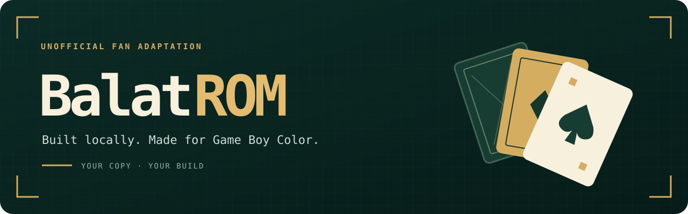

  

  <strong>Balatro, squeezed onto a Game Boy Color.</strong> 
  Bring your own copy. BalatROM builds the ROM on your computer.

  <a href="https://github.com/1kuna/balatrom/releases/latest"><strong>Download</strong></a> ·
  <a href="INSTALL.md">Install guide</a> ·
  <a href="docs/FAQ.md">FAQ</a> ·
  <a href="https://github.com/1kuna/balatrom/issues">Report a bug</a>

---

BalatROM is a free fan project that turns the copy of **Balatro** you already own into a native **Game Boy Color** game. No ROM gets downloaded or shared. The app reads your own install and builds everything locally.

## How it works

1. **Download the app** for Mac or Windows.
2. **Open it.** It finds your Balatro install automatically.
3. **Click Build.** A couple of minutes later you have a `.gbc` file.
4. **Play it** in your favorite Game Boy Color emulator.

The full walkthrough is in the [install guide](INSTALL.md).

## What you need

| | |
|---|---|
| **Computer** | Mac with Apple Silicon (macOS 15+) or Windows PC (64-bit) |
| **Balatro** | The Steam version, **1.0.1o** |
| **To play** | Any Game Boy Color emulator, like [SameBoy](https://sameboy.github.io/) |

## Good to know

- **It's a Game Boy Color version, not the full game.** Some jokers and features didn't make the cut to fit the hardware.
- **Only the Steam version 1.0.1o works right now.** If Steam updates Balatro, the builder will tell you it's not supported yet.
- **Real hardware isn't tested yet.** Flash carts and handhelds might work, but no promises.
- **Your runs don't carry over** between desktop Balatro and BalatROM.

## Found a bug?

[Open an issue](https://github.com/1kuna/balatrom/issues). Tell me your OS, what you clicked, and what went wrong. Please don't attach game files, ROMs or saves.

## Credits

[Balatro](https://www.playbalatro.com/) is made by LocalThunk and published by Playstack. If you haven't played it, go buy it. It's great.

BalatROM is an unofficial fan project. It isn't affiliated with or endorsed by LocalThunk or Playstack. Please don't share the ROMs you build.

BalatROM uses [GBDK](https://github.com/gbdk-2020/gbdk-2020) and [SDCC](https://sdcc.sourceforge.net/) to build the ROM. Third-party licenses ship inside the app, and the compiler source is attached to each release.

## What's next

I'll keep updating this version with fixes and more of the game.

If BalatROM gets popular and there's enough demand for a fuller game, I'll make my own version too. Star the repo or [open an issue](https://github.com/1kuna/balatrom/issues) to tell me what you'd want in it.

No Balatro install? Stay tuned.
